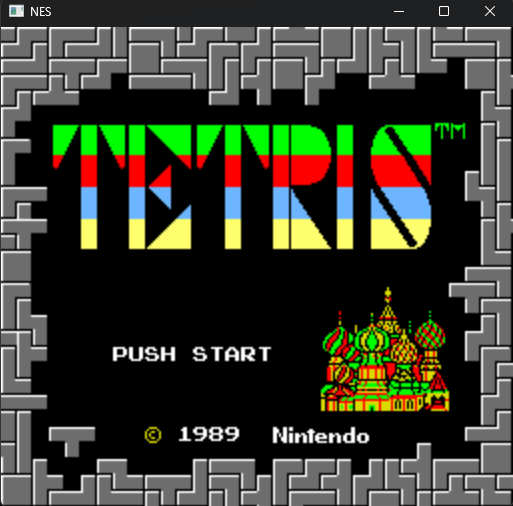

# NES Emulator

This project is a NES Emulator written in C with SDL3. This project is in it's early stages so a lot of things don't work

## Table of Contents
1. [Project Structure](#project-structure)
2. [Current Stage](#current-stage)
3. [Dependencies](#dependencies)
4. [Compiling_Source_Code](#compiling-source-code)

## Current Stage

The emulator can only run one game which is Tetris. Still there's a bunch of things left to do

## Project Structure
- `CMakeLists.txt`: Build tool
- `docs/`: My documents about this project
- `tests/`: Tests
- `palettes/`: NES palette files (.pal)
- `SDL`: SDL3 library submodule
- `googletest`: googletest framework submodule

## Dependencies
- SDL3
- googletest

## Compiling Source Code
1. Clone the repository.
2. Create the build directory `mkdir build && cd build`
3. Run cmake `cmake .. && cmake --build .`.
4. Run the binary `./nes`

## Contributing
I welcome contributions. If you have any bug fix or improvement, feel free to submit a pull request on the repository.
